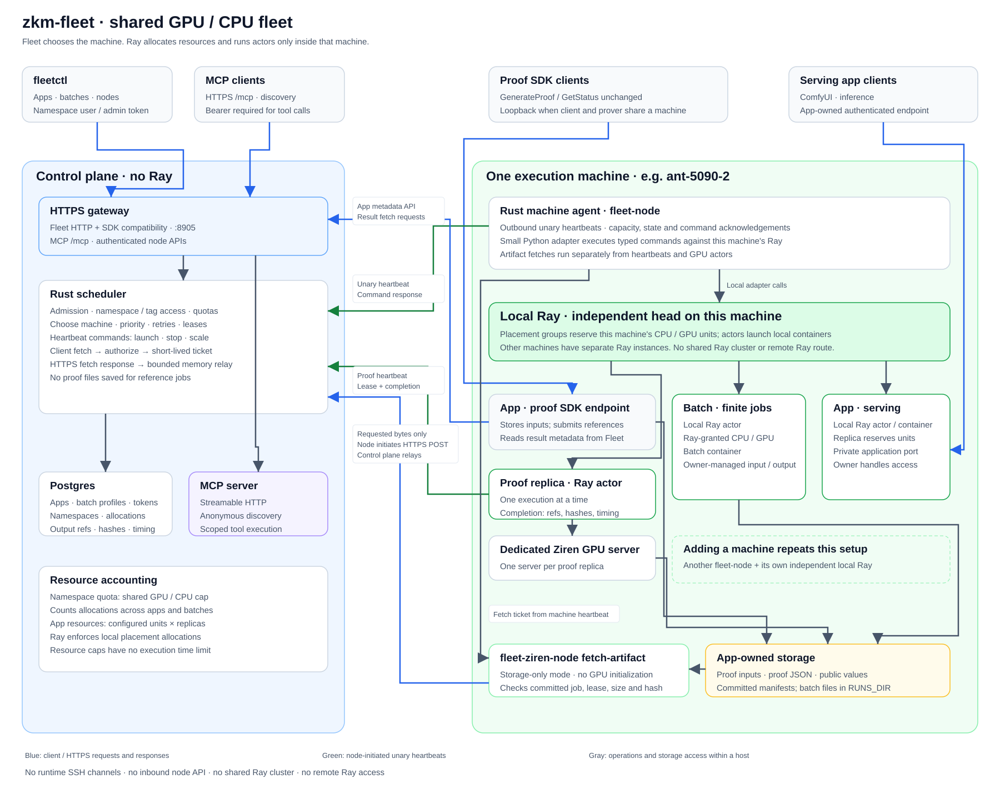

# zkm-fleet

Fleet schedules apps and batch jobs on shared GPU and CPU machines.

- **Apps** keep containers running: a model server, or a Ziren prover with its program.
- **Batches** run finite commands and release resources when cleanup finishes.

## Architecture

The control host runs the Rust scheduler, Postgres, an HTTPS gateway and, optionally,
MCP. Each execution machine runs `fleet-node` and its own local Ray, and connects
outward to register. Fleet handles admission, quotas, placement and lifecycle; apps
own their data and pipelines. The [code model](docs/reference.md#code-names) follows
Kubernetes' jobs, deployments and controllers, without needing Kubernetes.

Namespace owners create apps and batches and manage their priority, enabled state and
scaling, within their namespace's and tag's quotas; the scheduler picks each app's
node. Administrators manage namespaces, quotas, access, host storage for batches and
apps' execution settings.

Two integrated app workers prove on their node's own GPU server:

- **EthProofs** prepares witnesses, proves and reports every block in sequence,
  resuming from its saved cursor.
- **The GOAT proof builder** serves Bitcoin node proof requests, proves its five
  circuits and keeps its task database and proofs in app storage.

## Get started

1. [Install the control host and add a node](docs/installation.md).
2. [Inspect resources, scale apps and run batches](docs/operations.md).
3. [Adjust machine capacity, update and recover](docs/maintenance.md).

## Documentation

| Guide | Covers |
|---|---|
| [Installation](docs/installation.md) | Dependencies, binaries, control host, execution nodes and registration |
| [Operations](docs/operations.md) | Namespace commands, tags, node capacity, app scaling, batches and logs |
| [Maintenance](docs/maintenance.md) | Upgrades, Ray capacity changes, self-built programs, liveness and troubleshooting |
| [Reference](docs/reference.md) | Architecture, workloads, proofs, access, quotas, APIs, storage and ports |
| [EthProofs](apps/ethproofs/README.md) | Pinned source, worker build, sequential proving and durable recovery |
| [GOAT](apps/goat/README.md) | Pinned source, program bundle identity, packaging, cutover and recovery |
