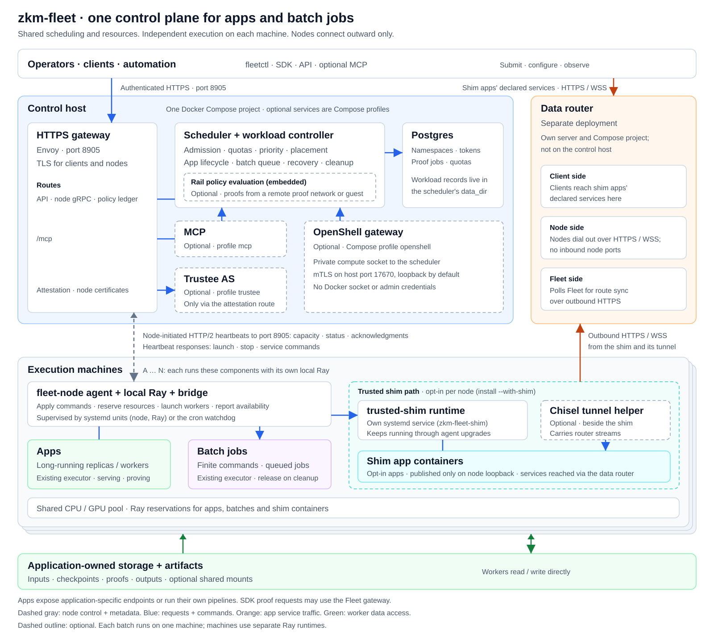

# zkm-fleet

Fleet schedules apps and batch jobs on shared GPU and CPU machines.

- **Apps** keep containers running: a model server, or a Ziren prover with its program.
- **Batches** run finite commands and release resources when cleanup finishes.

## Architecture

The control host runs the Rust scheduler, Postgres, an HTTPS gateway and, optionally,
MCP. Each execution machine runs `fleet-node` and its own local Ray, and connects
outward to register. Fleet handles admission, quotas, placement and lifecycle; apps
own their data and pipelines. The [code model](docs/reference.md#code-names) follows
Kubernetes' jobs, deployments and controllers, without needing Kubernetes.

Namespace owners create apps and batches and manage their priority, enabled state and
scaling, within their namespace's and tag's quotas; the scheduler picks each app's
node, and moves an app's start to a node with room when its own has none. Fleet copies
nothing an app keeps on a node's disks, so an app that keeps data there, or runs from
it, is anchored to that node with `machine` in its entry in the node's `apps.yaml`.
Administrators manage namespaces, quotas, access, host storage for batches and apps'
execution settings.

Two integrated app workers prove on their node's own GPU server:

- **EthProofs** prepares witnesses, proves and reports every block in sequence,
  resuming from its saved cursor.
- **The GOAT proof builder** serves Bitcoin node proof requests, proves its five
  circuits and keeps its task database and proofs in app storage.

## Runtime deployment (0.2)

Opt-in shim workloads use an independently supervised `trusted-shim-runtime`;
node-agent upgrades leave that process and existing containers running.
OpenShell is the default shared access layer for Docker and TEE drivers; without
user rules it adds no restrictions beyond driver limits. Its gateway is included
in Fleet’s default Compose stack. Trustee AS is an optional `trustee` Compose
profile for legacy attestation/prechecks; its appraisal RPC uses the existing
HTTPS ingress with node client certificates. TDX DCAP admission verifies original
evidence in a Ziren guest and does not require AS. Rail is embedded policy evaluation plus a remote proof guest.
The [Data Router](https://github.com/attestx/trusted-data-router/tree/feat/rust-framework/deploy)
has its own server and Compose project; runtime nodes need only outbound HTTPS/WSS.

GHCR publishes `ghcr.io/projectzkm/zkm-fleet-{scheduler,ctl,mcp,node,proof-app}`
with `sha-<full-commit>` tags and release versions. The unchanged native gateway
uses `zkm-fleet-openshell:<upstream-revision>`. The manual proof-image workflow
publishes `zkm-fleet-ziren-node:sha-<full-commit>` from an operator-validated
Ziren 2.0 GPU image digest; building it does not run a prover. The node image also
distributes binaries for the existing host installer; it does not replace local
Ray/bridge supervision or combine the shim lifecycle with the node process.

Existing workloads are not automatically migrated. Schema 20 requires a
[backup and compatible rollback plan](docs/maintenance.md); preserve application
data, cursors and identities before the initial upgrade. Policy-enabled deployments
must also coordinate Rail's v2 evaluator with the new guest, approved program key
and policy revisions; see [policy upgrades](docs/maintenance.md#policy-evaluator).

## Get started

1. [Install the control host and add a node](docs/installation.md).
2. [Inspect resources, scale apps and run batches](docs/operations.md).
3. [Adjust machine capacity, update and recover](docs/maintenance.md).

## Documentation

| Guide | Covers |
|---|---|
| [Installation](docs/installation.md) | Dependencies, binaries, control host, execution nodes and registration |
| [Operations](docs/operations.md) | Namespace commands, tags, node capacity, app scaling, batches and logs |
| [Maintenance](docs/maintenance.md) | Upgrades, Ray capacity changes, self-built programs, liveness and troubleshooting |
| [Reference](docs/reference.md) | Architecture, workloads, proofs, access, quotas, APIs, storage and ports |
| [EthProofs](apps/ethproofs/README.md) | Pinned source, worker build, sequential proving and durable recovery |
| [GOAT](apps/goat/README.md) | Pinned source, program bundle identity, packaging, cutover and recovery |

Node-configured TEE profiles use CoCo evidence and a synchronous remote RA receipt
gate in shim. The TDX guest reuses Automata DCAP; SNP/sample retain their separate
guest contracts and optional-to-the-stack Trustee adapter. Hardware and simulation are separate
capabilities; existing Docker workloads remain unattested. See the [configuration
and remaining hardware guest requirements](docs/reference.md#node-configured-tee-runtimes).
